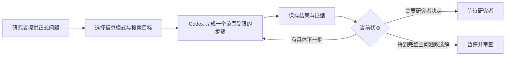

# 几何与数学研究工作区

[English](README.md) | **简体中文**

跨会话继续数学研究，并保留可检查的证据记录。

[](https://github.com/coker412/graph-geometry-research-workspace/actions/workflows/ci.yml)
[](LICENSE)

这个工作区帮助研究者使用 Codex 寻找证明、构造反例、核查文献和开展可复现实验。每个项目将问题、研究路线、证据、失败尝试和下一步保存在文件中，使研究可以继续推进，而不必依赖不断增长的聊天历史。

它适用于黎曼几何、几何分析、离散与图几何，以及各项目自行定义的其他数学领域。现有仓库名和目录名为保持兼容而保留，不限制研究主题。

[快速开始](#快速开始) · [完整示例](#完整示例) · [主要功能](#主要功能) · [研究模式](#研究模式) · [证据与发表](#证据与发表)

写作质量维护首先检查数学内容是否保真，再分别比较表达质量的不同方面，不自动给出质量分数。[开发样例](tools/tests/writing-quality.md)包含改写与保留原文的案例；它们是维护者自查，不是人工读者验证。

## 适合谁使用

适合需要尝试多条路线、反复检验反例或跨多个会话研究问题的个人研究者和小团队。工作区区分候选证明、计算观察、文献结果和研究者认可。队列可以轮换多个问题，也可以在专门的后台会话中持续处理一个问题。

框架负责组织研究，不保证证明正确，也不自带模型。定义、证明审查和发表决定仍由研究者负责。运行时调用已安装并完成登录的 Codex CLI。

## 快速开始

### 1. 获取工作区

```bash
git clone https://github.com/coker412/graph-geometry-research-workspace.git
cd graph-geometry-research-workspace
```

也可以在 GitHub 上点击 **Use this template**，建立自己的副本。

### 2. 检查环境

```bash
./setup.sh --check
```

基本运行环境需要 Git、Bash、Python 3 和 Codex CLI；后台运行还需要 tmux。计算默认使用 Conda 环境 `graphlab`。如需初始化环境且不安装可选的 Rethlas：

```bash
./setup.sh --bootstrap --without-rethlas
```

按需授权联网安装，并使用自己的账号登录。不要复制他人的 Codex 登录目录。

### 3. 添加问题

```bash
./queue.sh add my-problem "My conjecture"
```

填写 `problems/important-conjectures/items/my-problem/problem.md`，检查相邻的 `config.toml`，然后设置：

```toml
ready = true
```

正式问题由研究者确定。运行器保存输入快照；研究智能体不得改写原始问题陈述。

### 4. 先试一轮

```bash
./queue.sh check
./queue.sh once
```

`check` 检查环境及下一个符合条件的问题，不调用 Codex。`once` 执行一个范围受限的研究步骤，便于核对问题、权限和输出结构。

### 5. 后台运行

```bash
./queue.sh start
./queue.sh status   # 查看状态。
./queue.sh watch    # 查看输出；先按 Ctrl-b，再按 d 脱离会话。
./queue.sh stop     # 当前回合结束后安全停止。
```

后台会话使用 tmux，关闭终端后仍可运行。电脑休眠或关机会暂停或终止计算；已保存的状态可用于之后恢复。

## 完整示例

[`examples/tree-edge-count/`](examples/tree-edge-count/) 是一个人工构造的示例项目，研究“具有 n 个顶点的有限非空树有 n−1 条边”。它不包含私人研究材料，用来展示各类记录如何衔接：

```text
problem.md
    ↓
CURRENT_STATE.md
    ↓
ideas.md + research-tree.md + proof-map.md
    ↓
notes/proof.md
    ↓
verification-ledger.md + progress.md
```

示例中的候选证明仍标记为 `proof-draft`。论证看起来完整，不等于已经获得研究者的逐步认可。

## 主要功能

| 研究需求 | 工作区的支持 |
| --- | --- |
| 在新会话恢复研究 | `CURRENT_STATE.md` 记录范围、缺口和证据位置 |
| 避免重复失败路线 | `ideas.md` 和 `research-tree.md` 记录方法机制、失败原因与重启条件 |
| 跟踪未验证的依赖 | `proof-map.md` 和 `verification-ledger.md` 保留依赖关系与证据等级 |
| 区分实验与证明 | 计算证据初始标记为 `experimental` |
| 在多个问题间分配时间 | 公平轮换队列与单问题专用运行器 |
| 审查完整候选解 | 暂停整个问题，等待认证与研究者审查 |
| 跨多次调用推进同一任务 | `tools/research_tasks.py` 保留原始验收条件和未完成事项 |
| 复用已有结果 | 限定范围的文献比较和明确的应用条件核查 |
| 在瓶颈处尝试其他表述 | `agents/protocols/cross-field.md` 要求说明数学联系并实际检验 |
| 跟踪上下文与用量 | `tools/research_runtime.py` 和 `./queue.sh usage` |
| 对照计划与结果 | `tools/research_progress.py` 和 `./queue.sh progress` |
| 准备论文与学习稿 | `.agents/skills/` 中的两个 skill |
| 检查公开发布内容 | GitHub Actions、源文件清单和分发检查 |

## 研究如何推进



每次调用的范围有限。长期研究由连续调用和持久状态组成。每轮都应留下可检查的产物：推导、明确缺口、候选构造、有原因的失败路线，或可复现实验。

一个数学任务可以跨多次调用完成。证明一个方便的辅助引理不能替代原始验收条件：智能体必须尝试将其用于主问题，并记录剩余事项。在同一障碍上重复自报状态会触发方法机制比较，但不能据此声称已独立验证研究停滞。

普通回合使用一个研究智能体；增加智能体需要明确请求。配置为 `mixed-isolated` 的运行先执行隔离分支，再整合。重要辅助候选结果需要加强检查，并保留条件性依赖；完整主问题候选解需要整个问题的认证和暂停。

`AGENTS.md` 保存共同规则，`agents/core/` 和 `agents/protocols/` 提供当前阶段的指导，`agents/instructions/` 包含兼容索引、研究指导和论文规则。只加载当前任务需要的模块。

## 研究模式

信息访问、搜索目标、调度、持续时间和研究阶段是分别设置的维度。

| 维度 | 选项 | 用途 |
| --- | --- | --- |
| 信息访问 | `offline`、`connected`、`mixed-isolated` | 控制外部来源及其可追溯性 |
| 智能体策略 | `single`、`adaptive`、`swarm` | 描述已授权的分支使用方式；不是运行器配置字段 |
| 搜索目标 | `affirmative-proof`、`counterexample`、`either` | 寻找证明、反例，或二者之一 |
| 调度 | 单轮、公平队列、专用问题 | 分配执行时间 |
| 持续时间 | 有界试跑或连续运行 | 设置调用超时、尝试次数和总运行时间 |
| 阶段 | 探索或认证 | 根据证据状态选择检查强度 |

### 信息访问

- `offline` 使用正式问题、允许的背景事实、内部计算和可追溯状态，不能确认文献现状或新颖性。
- `connected` 允许外部核查。需阅读原始定理，并匹配全部假设与归一化约定。
- `staged` 是手动工作流：先冻结离线路线快照，再切换到联网核查。
- `mixed-isolated` 分别运行离线与联网分支，然后进行整合审查。通常需要三次 Codex 调用，并依赖 Linux `bubblewrap`；缺少隔离工具时会拒绝运行，不会静默退化为未隔离模式。

全局设置位于 `problems/important-conjectures/runner.toml`，单个问题的 `config.toml` 可以覆盖这些设置：

```toml
information_mode = "offline"
search_contract = "either"
```

### 调度

| 任务 | 命令 |
| --- | --- |
| 检查而不启动研究 | `./queue.sh check` |
| 对下一个问题执行一轮 | `./queue.sh once` |
| 轮换符合条件的问题 | `./queue.sh start` |
| 在后台专注一个问题 | `./queue.sh start --slug <slug>` |
| 查看该问题的会话 | `./queue.sh watch --slug <slug>` |
| 安全停止该问题 | `./queue.sh stop --slug <slug>` |

不同 slug 可以使用不同的 tmux 会话。同一个 slug 不能同时有两个运行器；公平队列也不能修改专用运行器已经接管的问题。

### 连续研究

将问题的 `max_attempts = 0` 可取消累计尝试次数限制，将全局 `max_wall_hours = 0` 可取消一次后台运行的总时间限制。仍应保留有限的单次调用超时，以便从 CLI 故障或计算卡住的状态恢复。

只有 `queued` 和 `pushing` 状态的问题自动参与轮换。问题含糊、需要外部授权、运行时故障或完整主问题候选解，都可能触发暂停。连续调度会消耗模型额度，不保证解决问题。

配置、提示词和恢复方式见[队列指南](problems/important-conjectures/README.md)。

## 项目记录

首次执行时，运行器创建：

```text
projects/conjecture-<slug>/
├── README.md
├── CURRENT_STATE.md
├── references.md
├── ideas.md
├── progress.md
├── research-tree.md
├── proof-map.md
├── verification-ledger.md
├── notes/
├── code/
├── lean/
├── rethlas/
├── input-snapshots/
├── CURRENT_INPUT.md
└── .conjecture-status
```

当前工作流使用自然语言证明和可复现计算。历史遗留的 `lean/` 目录不意味着要求形式化。

### 短状态与历史

`CURRENT_STATE.md` 是恢复入口：目标大小为 6 KiB，超过 8 KiB 警告；V2 上限为 12 KiB／300 行。旧版摘要暂时保留 32 KiB／300 行上限。先读正式问题和短状态，再按稳定 ID 与直接证据位置查阅材料。

已有队列项目使用：

```bash
./queue.sh state-init
./queue.sh state-audit
```

非队列项目使用：

```bash
./tools/project_state.py init
./tools/project_state.py audit
```

初始化不会覆盖现有摘要。旧项目从 `migration-status: pending` 开始，迁移时检查最近的完整回合和引用证据。未读历史仍视为未知，迁移不能提升证据等级。

### 磁盘维护

```bash
./queue.sh hygiene report
./queue.sh hygiene latex
./queue.sh hygiene logs --older-than-days 30 --keep-latest-per-slug 5
```

这些命令默认报告或预览改动。只有显式使用 `--apply` 才会删除可重建的 LaTeX 中间文件或无损压缩旧 JSONL 日志。项目环境不会自动删除。

## 上下文与用量

运行器按研究阶段选择推理强度，将相关规则、问题、短状态和证据片段组合成研究包。研究包超过硬上限时，会在调用模型前拒绝执行。已有路线从当前缺口继续，不必反复读取全部历史。

```bash
./queue.sh packet --slug <slug>        # 预览初始上下文大小。
./queue.sh usage                       # 汇总已记录的用量。
./queue.sh usage --slug <slug> --json  # 查看结构化统计。
./queue.sh progress --slug <slug>     # 对照计划与报告的结果。
```

输入、缓存输入、输出 token 和耗时分别统计。缺失的用量保持未知。上下文预算按 UTF-8 字节计量，只约束初始研究包，不是计费上限。工作区不计算金额账单，也不声称已通过实验确立节省比例。

[运行时指南](shared/runtime-v2-guide.md)说明预算、事务与恢复；[进展指南](shared/research-progress-guide.md)区分数学进展、执行状态与自报活动。用量统计和结构检查不能提升证据等级。

## 数学写作与论文学习

仓库与分发包包含独立 [math-paper-skills 仓库](https://github.com/coker412/math-paper-skills)所提供的两个 skill：

- [math-paper-writing](.agents/skills/math-paper-writing/SKILL.md)：论文起草与修改、证明表达、中英文一致性、LaTeX、投稿材料和 Writing DNA 蒸馏。
- [math-paper-study-guide](.agents/skills/math-paper-study-guide/SKILL.md)：局部证明解释，或带可编辑源、先修知识、完整计算和证明重建的学习 PDF。默认中文，也可以指定其他语言或仅在对话中解释。

可选的 [Tao、Evans、Stanley、Mumford 和 Milnor 画像](.agents/skills/math-paper-writing/references/field-profiles.md)各使用二十篇完整且去重的训练作品，并提供五份分析报告。标准蒸馏至少使用二十篇；用户明确选择的小样本模式也支持三篇以上的暂定画像。来源、检查过的段落、文体和局限均有记录。只加载当前任务相关的画像。Tao 的跨领域样本包含十八篇研究论文或短文、两篇综述，没有预留未读的对照文章。

写作 skill 内置[原版 Writing DNA](.agents/skills/math-paper-writing/assets/writing-dna-skill/SKILL.md)、两种语言的模板、原版引用的清理 skill，以及固定版本的来源记录。数学蒸馏直接调用原版流程，入口有一处已记录的数学适配链接；普通改稿不加载整套蒸馏材料。

[公开样例](examples/math-paper-skills/README.md)首先展示从十六组局部试写中选出的[六组改写对照](examples/math-paper-skills/04-selected-revisions.md)，包含原段完整中译、实际英文改写及数学内容保留说明。较早的摘要和证明概览样例讨论编辑取舍，Hessian 计算样例展示学习 skill。样例均使用固定版本的 OpenAI 公开稿件；筛选和自查不能证明平均效果或独立验证通过。

两个 skill 都包含可选的 `scripts/pdf_pages.py` 和 `scripts/check_tex_log.py`。运行时可先查看 `--help`，不必加载实现。PDF 提取需要 PyMuPDF，可复用与源文件哈希绑定的分页缓存；日志扫描只需要 Python 标准库。这些工具减少重复文件处理和诊断输出，但不替代原文阅读、项目构建或数学审查。

调用 `$math-paper-writing` 或 `$math-paper-study-guide` 并指出源文件即可。Writing DNA 已内置；anti-defensive-writing 和 Humanizer 是可选辅助工具。工作区之外的安装方式与发布检查范围见[独立仓库说明](https://github.com/coker412/math-paper-skills#readme)和[测试记录](https://github.com/coker412/math-paper-skills/blob/main/TESTING.md)。

请遵循[论文规则](agents/instructions/paper-writing.md)。活动稿件、候选稿件及其构建产物从首次写入起就应位于所属项目的 `paper/` 目录。修改后重建受影响版本并检查日志。语言和排版检查不能验证证明。

## 证据与发表

| 等级 | 含义 |
| --- | --- |
| `conjecture` | 尚无证明 |
| `experimental` | 只有计算证据 |
| `partial-result` | 特殊情形或较弱结论 |
| `proof-draft` | 完整候选论证，等待严格验证 |
| `agent-verified` | 经独立智能体或验证者审查 |
| `human-verified` | 经研究者逐步审查并明确认可 |
| `formalized` | 经形式系统检查；保留历史证据标签 |

单靠计算不能确立定理。自查不是独立验证，模型能力、文字润色和状态维护也不能提升证据等级。投稿稿件中不加限定地陈述主结果，需要 `human-verified` 或 `formalized` 证据，以及研究者授权。

### 公开分发边界

仓库公开框架、模板、工具、测试、可复用的写作 skill 和人工构造的示例。研究目录只含占位文件；`shared/` 还包含两份公开运行指南。隐藏目录 `.agents/` 只包含明确列入允许清单的 skill 资源。

私人论文、研究记录、日志、环境和凭据均不分发。公开仓库是框架分发的源头；私人工作区可以保留本地扩展，但不能被递归复制到公开仓库。

提交前运行：

```bash
python tools/update_manifest.py write
./tools/verify_teacher_framework.sh --public-source
python -m unittest discover -s tools/tests -v
python .agents/skills/math-paper-writing/scripts/check_skill_resources.py
```

检查涵盖文件清单、私人数据边界、禁止分发的文件类型、常见密钥模式和允许的 skill 资源。GitHub Actions 会在推送和 PR 时重复检查，并实际运行一次完整分发导出。

## 可选的 Rethlas 集成

普通队列只需要 Codex。Rethlas 是可选的证明生成与验证工具，用于精确陈述的缺口。应安装在工作区之外，每次使用都需获得明确授权。

队列不会自动启动 Rethlas。生成一个论证本身不代表问题已经解决。准备材料、tmux 会话和结果导入方式见 [Rethlas 指南](RETHLAS使用教程.md)；为保持脚本兼容，保留其现有文件名。

## 文档

- [队列快速开始](TEACHER_QUEUE_QUICKSTART.md)
- [环境安装](TEACHER_SETUP_README.md)
- [框架交接](TEACHER_FRAMEWORK_HANDOFF.md)
- [队列配置与恢复](problems/important-conjectures/README.md)
- [研究规则](AGENTS.md)
- [AI 安装指导](SETUP_AI_PROMPT.md)
- [几何对象与约定](agents/protocols/geometry-scope.md)
- [个人研究工作流](agents/instructions/personal-research.md)

## 许可证

采用 MIT 许可证。保留版权和许可声明后，可以复制、修改和再分发本框架。
